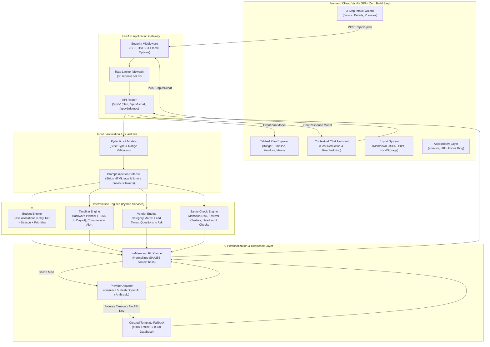
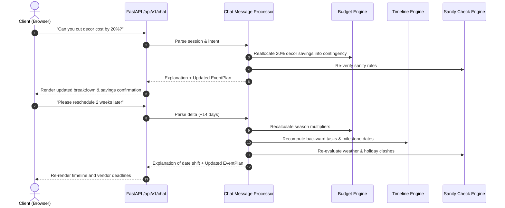

# 🏛️ UtsavAI System Architecture Documentation

> **UtsavAI – Smart Celebration & Event Planner**  
> Comprehensive technical architecture, deterministic engine algorithms, GenAI hybrid orchestration, security, and accessibility models.

---

## 1. System Overview & Persona

### Vertical & Persona
- **Vertical:** Celebration & Event Planning for the Indian cultural ecosystem (Weddings, Birthdays, Community Diwali/Eid/Navratri Melas, College Fests, and RWA Society functions).
- **Primary Persona:** *Priya*, a 32-year-old event organizer in Delhi who coordinates family milestones, community festivals, and social gatherings. She requires:
  - Instant, accurate budget allocations denominated in Indian Rupees (₹ INR).
  - Cultural awareness (muhurat / auspicious season pricing, religious dietary customs like Jain/Satvik/Halal).
  - High resilience (works 100% offline with zero external API key requirements).
  - Low-bandwidth optimization (<10 MB total repo, vanilla zero-build SPA).

### Core Architectural Principle: Hybrid Deterministic + GenAI
Traditional generative AI models frequently hallucinate arithmetic, misquote currency, produce impractical timelines, or propose unrealistic budgets. UtsavAI solves this by splitting responsibilities:

1. **Deterministic Rule Engines (100% Offline & Reproducible):**
   - Handle mathematical budget allocations in Indian Rupees (INR).
   - Compute backward-planned milestone timelines from the event date.
   - Generate vendor checklists with lead-time rules and contract questions.
   - Execute cultural calendar and monsoon clash sanity checks.

2. **GenAI Personalization Layer (Async, Cached, Fallback-Resilient):**
   - Focuses strictly on creative, non-mathematical tasks: theme names, creative decor motifs, custom menu curation, bilingual invitation wording, party games, and emotional toasts.
   - Employs a strict JSON schema contract, batched single-call inference, and offline template fallbacks.

---

## 2. High-Level Architecture Diagram



---

## 3. Deterministic Engine Logic & Mathematical Formulas

### 3.1 Budget Allocation Engine (`backend/services/budget_engine.py`)

The budget engine guarantees that total allocations and contingency sum to exactly 100% of the user's budget with zero mathematical errors.

$$\text{Final Budget} = \text{Distributable Budget} (90\%) + \text{Contingency} (10\%)$$

#### 1. Season Multiplier ($S_m$)
- **Peak Season (Oct–Feb):** $S_m = 1.20$ (Highest demand due to auspicious wedding dates and festival clusters).
- **Shoulder Season (Mar–Apr, Sep):** $S_m = 1.05$ (Moderate availability and pricing).
- **Off-Season (May–Aug):** $S_m = 0.90$ (High summer heat and monsoon periods).

#### 2. City Tier Multiplier ($C_m$)
- **Metro (Delhi, Mumbai, Bengaluru, etc.):** $C_m = 1.45$
- **Tier-2 (Jaipur, Lucknow, Pune, Chandigarh, etc.):** $C_m = 1.20$
- **Tier-3 (Smaller towns and districts):** $C_m = 1.00$

#### 3. Guest Count Economy of Scale ($G_s$)
$$\text{Scale Factor } G_s = 
\begin{cases} 
1.10 & \text{if } \text{guests} \le 50 \\
1.00 & \text{if } 50 < \text{guests} \le 150 \\
0.92 & \text{if } 150 < \text{guests} \le 500 \\
0.85 & \text{if } 500 < \text{guests} \le 1000 \\
0.78 & \text{if } \text{guests} > 1000 
\end{cases}$$

#### 4. Priority Redistribution
User-selected priority categories receive an upward shift (e.g., +20% for first priority, +10% for second, +5% for third). This delta is proportionally balanced away from non-priority categories while enforcing non-zero floors for essential services.

#### 5. Realistic Minimum Benchmark
$$\text{Minimum Viable Budget} = \text{Base Per-Head Minimum} \times C_m \times S_m \times G_s \times \text{Guest Count} \times 1.10$$

If the user's entered budget falls below this realistic minimum, the engine dynamically generates advisory warnings and a recommended budget without rejecting the submission.

---

### 3.2 Backward-Planned Timeline Engine (`backend/services/timeline_engine.py`)

The timeline engine schedules every event task backward from the event date ($T=0$):

$$\text{Task Execution Date} = \text{Event Date} - \text{Offset Days}$$

- **Event Complexity Offsets:**
  - Weddings: Up to 365 days ($T-365$ for initial budget and family consult, $T-270$ for date & muhurats, $T-240$ for venue, $T-180$ for caterer, $T-30$ for invitations, $T-3$ for vendor sync, $T-0$ for coordination).
  - Birthdays & Anniversaries: 30 to 45 days.
  - Diwali Melas & Fests: 90 days with municipal and police NOC milestones at $T-45$.
- **Compression Detection:** If the user creates a plan with fewer than 30 days until the event date, the engine flags `is_compressed = True`, recalculates all past milestones into urgent immediate action items, and generates warning alerts.

---

### 3.3 Vendor Checklist Engine (`backend/services/vendor_engine.py`)

Builds an exhaustive, category-wise procurement checklist:
- Maps event type and venue type to mandatory categories (e.g., sound licenses and generator backup for outdoor grounds).
- Calculates estimated cost ranges per vendor scaled by city tier and event budget.
- Injects 4–5 culturally specific vendor interview questions (e.g., for catering: separate Jain/veg prep zones, tasting sessions, food safety clearances).

---

### 3.4 Sanity & Cultural Conflict Engine (`backend/services/sanity_checks.py`)

Applies rule-based validation checks:
1. **Past Date Check:** Validates event date occurs in the future.
2. **Monsoon Weather Risk:** Flags outdoor events in coastal/monsoon zones between June 15 and September 15.
3. **Indian Festival Date Clashes:** Checks against major Indian holidays (Diwali, Dussehra, Navratri, Eid, Christmas, New Year) to warn about vendor scarcity and peak surcharge pricing.
4. **Budget per Head Realism:** Compares budget per guest against base city-tier living indexes.
5. **Mega Gathering Logistics:** Recommends crowd management, first aid, and ambulance access for gatherings exceeding 500 guests.

---

## 4. Chat Assistant & Engine Re-run Flow

The chat assistant supports dynamic state modifications without losing previous context:



---

## 5. Security Architecture

1. **Strict Input Sanitization:**
   - All inbound strings are processed through `strip_and_sanitize_strings` which removes HTML/XML tags (`<...>` via regular expressions) and scrubs prompt injection keywords (`ignore previous instructions`, `system:`, `jailbreak`, `admin mode`).
   - Numerical bounds are enforced via Pydantic (`guest_count`: 1–10,000, `total_budget_inr`: ₹1,000–₹100,000,000).
2. **Safe API Key Management:**
   - Keys are loaded into `pydantic-settings` from environment variables.
   - Zero API keys are serialized into logs, responses, or client artifacts.
3. **HTTP Hardening:**
   - `Content-Security-Policy: default-src 'self'; script-src 'self'; style-src 'self' 'unsafe-inline'; img-src 'self' data:; connect-src 'self';`
   - `X-Content-Type-Options: nosniff`
   - `X-Frame-Options: DENY`
   - `Referrer-Policy: strict-origin-when-cross-origin`
4. **Rate Limiting:**
   - Global rate limit of 30 requests/minute per client IP via SlowAPI.

---

---

## 6. Accessibility & Frontend Engineering

- **Native ES Modules Architecture (Zero Build Step):**
  - Loaded via `<script type="module" src="/static/js/main.js"></script>` without bundlers or node_modules dependencies.
  - Granular, single-responsibility files under `public/static/js/`:
    - `constants.js`: Domain constants, defaults, and API endpoints.
    - `state.js`: Central reactive state store with listeners.
    - `dom.js`: DOM querying, safe HTML escaping, formatting helpers.
    - `i18n.js`: English / Hindi translation dictionaries separate from logic.
    - `theme.js`: Dark/light mode theme management.
    - `api.js`: Async client communicating with `/api/v1/*` endpoints.
    - `chat.js`: Interactive conversational assistant panel logic.
    - `export.js`: Markdown and JSON exporter + print generation.
    - `render/`: Specialized rendering modules (`budget.js`, `timeline.js`, `vendors.js`, `ideas.js`).
    - `main.js`: Main entrypoint coordinating wizard steps, tabs, and event bindings.
  - Modular CSS in `public/static/css/`: `base.css`, `layout.css`, `components.css`, `responsive.css`, and `a11y.css`, imported into root `style.css`.
- **Dual Live Regions:**
  - `#aria-live`: `aria-live="polite"` for non-disruptive announcements (tab navigation, theme toggle).
  - `#aria-assertive`: `aria-live="assertive"` for critical form errors and sanity alerts.
- **Visible Focus:** Global `:focus-visible` ring using high-contrast Saffron (`#F59E0B` on dark, `#D97706` on light) with 3px offset.
- **Reduced Motion:** Comprehensive `@media (prefers-reduced-motion: reduce)` overrides to neutralize animations.
- **Bilingual i18n:** Dynamic client-side dictionary toggle switching all UI headings, form labels, and button prompts between English and Hindi.

---

## 7. Modular Backend Layout

```
backend/
├── api/
│   └── routes.py             # HTTP route definitions, status codes, serialization
├── constants.py              # Centralized domain constants, multipliers, calendar rules
├── exceptions.py             # Custom domain exception hierarchy
├── config.py                 # Pydantic BaseSettings and cached configuration
├── data/
│   └── demos.py              # Curated demo event scenarios
├── models/
│   └── schemas.py            # Pydantic v2 domain schemas and validators
├── services/
│   ├── ai_service.py         # Multi-provider LLM orchestration, caching, template fallbacks
│   ├── budget_engine.py      # Deterministic mathematical budget allocation
│   ├── chat_service.py       # Pure intent parsing and dynamic plan update engine
│   ├── sanity_checks.py      # Cultural calendar, monsoon, and budget sanity engine
│   ├── timeline_engine.py    # Backward-planned milestone generation & compression
│   └── vendor_engine.py      # Vendor requirements matrix, lead times, and questionnaires
└── utils/
    └── config.py             # Backward-compatibility alias to backend.config
```
